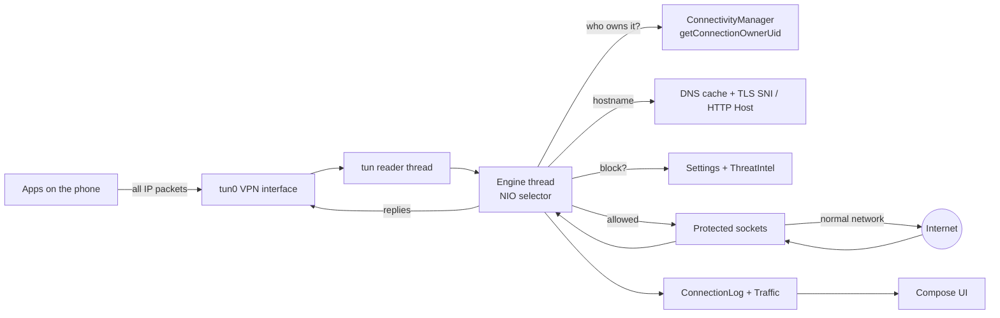

# Hodor architecture

This explains how Hodor sees, attributes, blocks and relays traffic, and where each piece lives in the code. Paths are relative to `app/src/main/java/com/portwatch/`.

## Big picture

Android allows one app at a time to hold the VPN. Hodor's VPN is local: it ends at the `Engine`, which relays each allowed connection through an ordinary socket marked with `VpnService.protect()`, so that socket goes straight out over Wi-Fi or mobile data and doesn't loop back into the VPN.

## The VPN service — `vpn/PortWatchVpnService.kt`

On **start** it:
- reads the real network's DNS server (first IPv4 one, else a non-link-local IPv6 one, else `8.8.8.8`); this becomes the **upstream resolver**;
- builds the VPN interface with:
  - address `10.111.0.1/32` and a route for all IPv4 (`0.0.0.0/0`);
  - IPv6 address `fd00:7077::1/128` and route `::/0`, **only if** the real network has a global IPv6 address (otherwise apps would try IPv6 first and stall);
  - DNS server `10.111.0.53`, a fake address that Hodor answers itself;
  - MTU 1500, blocking reads, `setMetered(false)` so the VPN follows the real network's metered state;
  - Hodor's own app excluded, so its list downloads and IP lookups go out directly;
- resets the session counters (`Traffic.reset()`) and starts the `Engine`.

On **stop**, or **revoke** (another VPN took over, or the user turned it off in Settings), it stops the engine and closes the interface.

## The engine — `vpn/Engine.kt`

Two threads:

| Thread | Job |
|---|---|
| `pw-tun-reader` | Blocking reads from the tun interface; hands each packet to a queue. |
| `pw-engine` | The only thread that touches connection state. Runs a NIO `Selector` loop: handles queued packets and rule-change tasks, services ready sockets, sweeps idle flows every 5 s, and once a second publishes the connection log and ticks the speed counters. |

Packet parsing and building (IPv4/IPv6, TCP, UDP, checksums) is in `vpn/Packet.kt`.

### DNS remapping

Apps send DNS to `10.111.0.53`. The engine forwards port 53 (UDP and TCP) to the upstream resolver and sends the replies back as if they came from `10.111.0.53`. Any other port on that address is refused, which makes Android's "Private DNS: Automatic" fall back to plain DNS. That keeps lookups visible, so Hodor can show per-app hostnames.

### TCP relay — `vpn/TcpFlow.kt`

Hodor ends each app TCP connection inside the VPN and opens its own socket to the destination:

1. **SYN** from the app: open a protected `SocketChannel` and connect.
2. When that connect succeeds, send the app a SYN-ACK; on failure, send RST.
3. Data from the app is acknowledged and queued to the socket. The advertised window is `65535 − bytes not yet written`, which provides backpressure.
4. Data from the socket is sent to the app in MSS-sized segments, never more than the app's window allows.
5. FIN and RST from either side are handled, including half-close.

Simplifications, which hold because the tun interface is local and doesn't lose packets: no retransmission timer; no window scaling or SACK offered; out-of-order segments are dropped and re-acknowledged.

Idle limits: 30 s while connecting, 60 s once either side has closed, 30 min for an established connection.

The first 8 KB the app sends are inspected for a **TLS SNI** or **HTTP Host** hostname (`data/Hostnames.kt`, `Sniffer`).

### UDP relay — `vpn/UdpFlow.kt`

Each app UDP socket (by local port and destination) gets one protected `DatagramChannel`. DNS replies are parsed to learn which IPs belong to which names (`DnsCache`), and each outgoing DNS query's name is recorded. Idle limits: 15 s for DNS, 120 s otherwise.

## Who owns a connection

For each new flow the engine calls `ConnectivityManager.getConnectionOwnerUid(protocol, local, remote)`. Android only allows the active VPN app to ask this, which is why Hodor is a VPN at all. `data/AppResolver.kt` turns the uid into an app name and icon (it needs `QUERY_ALL_PACKAGES`). A few system uids get fixed names, such as `0` → Kernel/root and `1000` → Android System.

## Where hostnames come from

In order of preference:
1. For a DNS lookup, the name being looked up.
2. For a TCP connection, the TLS SNI or HTTP Host in its first bytes.
3. Otherwise, the name the destination IP was last returned for in a DNS answer (`DnsCache`).

Whenever a record's hostname is set, it's checked against the threat lists and the ads list (`data/ConnectionLog.kt`, `ConnectionRecord.host`).

## Blocking decisions

`Engine.shouldBlock(record)` is true when **any** of these hold:

| Rule | Setting |
|---|---|
| The app is blocked | Apps → **Block** (`Settings.blocked`) |
| The destination is on a threat list | Shield → **Block flagged destinations** |
| The destination is an ad/tracker domain, and the app isn't exempt | Shield → **Block ads & trackers**, Apps → **Allow ads** |

Where the decision is applied:

| Moment | Action |
|---|---|
| New TCP connection | RST to the app; record marked `blocked` |
| New UDP flow | Dropped; the socket is remembered for 60 s so retries don't each create a record. DNS gets an NXDOMAIN answer so the app gives up immediately. |
| Each DNS query on an existing flow | NXDOMAIN if the name is blocked for that app (`Engine.blocksName`) |
| TCP hostname learned from SNI/Host | The connection is cut if it now matches a rule |
| A rule changes | The engine re-checks every open flow and cuts those now blocked (`Engine.applyRules`) |

## Lists — `data/ThreatIntel.kt`

**Threat lists** (always on):

| List | Format | Content |
|---|---|---|
| URLhaus (abuse.ch) | hosts file | malware distribution sites |
| Phishing Army | domains | phishing domains |
| Feodo Tracker (abuse.ch) | IPs | botnet command-and-control servers |
| ET Compromised (Proofpoint) | IPs | compromised hosts |
| FireHOL Level 1 | IPs / CIDR | attack sources, hijacked networks |

**Ads list** (only while ad blocking is on): HaGeZi wildcard domains, **Normal** (`multi-onlydomains.txt`) or **Light** (`light-onlydomains.txt`).

**Matching:**
- A domain matches if it, or any parent domain down to two labels, is listed. So `x.ads.example.com` matches `ads.example.com` or `example.com`.
- IPv4 lists are merged into sorted ranges and searched with binary search. Private, local and reserved addresses are never matched, because FireHOL lists bogon ranges like `10.0.0.0/8`.

**Storage and refresh:**
- Files are kept in `files/threats/<id>.txt` (the ads list is `ads.txt`).
- A scheduled check runs every hour and downloads only the lists that are due under the chosen schedule (Daily, Weekly or Manual).
- With **Only on Wi-Fi** on, it skips metered networks.
- Each request sends `If-None-Match` and `If-Modified-Since`, so an unchanged list costs a `304` reply instead of a download.
- **Update now** downloads everything on any network.
- Switching ad blocking on downloads the ads list immediately.
- The ads list (~170,000 domains) is only kept in memory while ad blocking is on.

## Site filtering — `data/Filter.kt`, `vpn/BlockPage.kt`, `data/Notifier.kt`

**Rules.** Enabled category lists (downloaded into `files/filter/<id>.txt` through the shared `ThreatIntel.fetch`, except the built-in Dating list), your block and allow rules, temporary allows, and per-app exemptions. Matching walks the hostname and each parent domain down to two labels; **allow rules and temporary allows beat everything except a blocked app.**

**DNS** (`Engine.dnsVerdict`, applied per query in `UdpFlow`):

| Order | Condition | Answer |
|---|---|---|
| 1 | Name covered by an allow rule / temporary allow | forwarded |
| 2 | Threat list match, **Block flagged destinations** on | NXDOMAIN |
| 3 | Site-filter match (app not exempt) | **A → 10.111.0.80** (the block address); other types → empty answer; notification |
| 4 | Ads list match, ad blocking on for the app | NXDOMAIN |
| 5 | Query type 65 ("HTTPS"/SVCB) while filtering and bypass protection are on | empty answer, which turns off ECH |

**Connections.** `Engine.shouldBlock` also checks site filtering, using the connection's hostname (DNS cache, then TLS SNI / HTTP Host). TCP to a filtered site gets RST; a TLS/HTTP hostname that turns out to be filtered cuts the connection. Each is recorded (`ConnectionRecord.filter`) and notified.

**QUIC.** While filtering, UDP 443 is dropped silently (unless the app is exempt). Browsers fall back to TCP, where the SNI check works. With **Block QUIC** off, only QUIC to a known-filtered name is dropped.

**Block page.** `BlockPage` runs a tiny HTTP server on `127.0.0.1` (random port). The engine relays TCP 80 to 10.111.0.80 to it, and it answers with an HTML page (HTTP 403) built from the `Host` header: the illustration, the site and the reason. Port 443 to 10.111.0.80 is refused, because a block page over HTTPS would need a trusted certificate.

**Notifications.** `Notifier.held` records the event in `BlockLog` (shown as **Recently held**) and posts a notification, at most once per app and site every 2 minutes, if notifications are allowed (Android 13+ asks when you first enable filtering). The notification opens `BlockedActivity`; its **Allow 15 min** action goes to `AllowReceiver`.

**Illustration.** `res/drawable/hold_the_door.xml`, and the same artwork as SVG in `BlockPage.ART_SVG`: an original, faceless, back-lit giant holding a door frame, not a likeness of any character.

## IP locations — `data/GeoResolver.kt`

- New public IPs are queued and looked up in batches of up to 100 via `http://ip-api.com/batch`.
- The free tier allows 15 batches a minute; the code follows the server's `X-Rl` and `X-Ttl` headers and backs off 60 s on HTTP 429.
- Results are cached in `files/geo.json` (up to 5,000 entries).
- Plain HTTP is allowed for `ip-api.com` only (`res/xml/network_security_config.xml`).
- **Look up IP locations** pauses the lookups.

## Stats — `data/Traffic.kt`, `data/ConnectionLog.kt`

- Every change to a record's byte counts also updates session-wide counters.
- The engine samples them once a second into a 60-second history for the speed graphs.
- The connection log keeps up to 3,000 records (closed ones are dropped first) and publishes an immutable snapshot (`ConnView`) to the UI once a second.

## Settings — `data/Settings.kt`

Stored in the shared preferences file `hodor`:

| Key | Meaning |
|---|---|
| `blocked` | blocked app keys (package name, or `uid:N`) |
| `block_threats` | block flagged destinations |
| `geo_online` | look up IP locations |
| `block_ads` | block ads and trackers |
| `ad_level` | `LIGHT` / `NORMAL` |
| `ad_allowed` | app keys exempt from ad blocking |

List metadata (timestamps, ETags, schedule, Wi-Fi only) is stored in the preferences file `threats`.

## User interface — `ui/`

| File | Contents |
|---|---|
| `Theme.kt` | colour palette (`Hodor` object), Outfit and Oxanium fonts, type scale |
| `Components.kt` | cards, pills, status chips, app icons, sparkline, segmented bar, power button, formatting helpers |
| `MainScreen.kt` | background glow, header (logo, LIVE chip, clear, search), bottom navigation |
| `HomeTab.kt` | map-first home: world map (projection, country shading, dot clustering, zoom), status, speeds, totals, protection score, ads summary, countries, version |
| `ListTabs.kt` | Traffic, Apps, Ports and Shield screens |

**Protection score** (home): starts at 100 and subtracts 20 if not watching, 15 per known-bad destination contacted (up to 60), 10 if flagged traffic isn't blocked, and 15 if the threat lists are missing or more than 3 days old. Each deduction is listed under the bar.

**Logo:** `res/drawable/ic_launcher_foreground.xml`, `ic_launcher_mono.xml` (themed icon) and `ic_logo.xml` (in-app). It's an arched doorway whose posts and barring beam form an H: "hold the door". It's an original drawing, not a likeness of the character.
